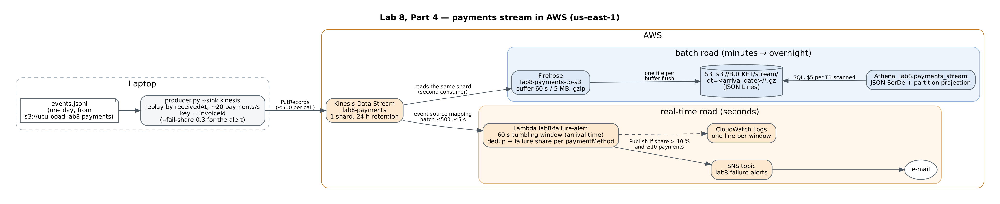

# Lab 8 — Big Data on AWS: the Uklon example

Two roads for the same data: **batch** (Athena + Glue over S3, answers overnight) and **stream**
(Redpanda locally, SQS + Lambda in the cloud, answers in seconds). Code: [`lab8/`](../lab8/).
Lab 8 runs in **us-east-1** (the dataset bucket is there and copying inside one region is free),
not in eu-central-1 like the Spry stack.

## What is where

| Part | Files |
|---|---|
| 2 — batch | `lab8/athena/setup.sh` (own bucket + S3→S3 copy), `lab8/athena/sql/01…16_*.sql`, `lab8/athena/run_athena.py` (runs them, saves CSV + run time + Data scanned to `lab8/athena/results/`), `lab8/athena/crawler.sh` (Way B) |
| 3 — local stream | `lab8/docker-compose.yml` (Redpanda + Console + `payments` topic, 3 partitions), `lab8/producer.py`, `lab8/consumer.py`, `lab8/compare_windows.py`, **`lab8/run_part3.py`** (all four experiments in one run → `lab8/data/part3/`) |
| 4 — cloud stream | `lab8/cloud/up.sh` / `down.sh` + `stream_lambda.py` (Free plan: SQS → Lambda → S3 + SNS), `lab8/cloud/up-kinesis.sh` / `down-kinesis.sh` + `kinesis_alert_lambda.py` (the diagram's Kinesis + Firehose version, needs the Paid plan), `lab8/cloud/sql/*.sql`, **`lab8/run_part4.py`** (up → produce → Athena → down), diagram [`docs/lab8/part4-pipeline.png`](lab8/part4-pipeline.png) |

## Run sheet

Git Bash in the repo root, `aws configure` done, Python 3.12+:

```sh
pip install -r lab8/requirements.txt

# Part 2
bash lab8/athena/setup.sh                                   # prints BUCKET=lab8-payments-<account>
python lab8/athena/run_athena.py --bucket $BUCKET           # 16 queries -> lab8/athena/results/
BUCKET=$BUCKET bash lab8/athena/crawler.sh                  # Way B, prints both schemas

# Part 3
mkdir -p lab8/data
aws s3 cp s3://ucu-ooad-lab8-payments/payments/dt=2026-10-01/events.jsonl lab8/data/ --no-sign-request
docker compose -f lab8/docker-compose.yml up -d             # Console: http://localhost:8080
python lab8/run_part3.py                                    # all 4 experiments, ~11 min (Docker running)

# Part 4 (we ran it in AWS CloudShell; creates, uses and deletes everything, ~5 min)
python lab8/run_part4.py --bucket $BUCKET --email you@example.com
```

---

## Part 1 — Uklon's data architecture

**The real-time road falls 10 minutes behind.** Everything that needs *now* breaks: matching works
on driver positions from 10 minutes ago (a driver who moved 5 km is offered a ride next to him),
surge is computed for demand that has already gone, the passenger sees the car standing still,
alerts come after the damage. Rides are lost and money is mispriced — immediately. Nothing is lost
from the data itself: Kinesis keeps the records (24 h by default), so Flink catches up, but the
decisions taken in those 10 minutes cannot be redone.
**The batch road falls a day behind.** Today's dashboards show the day before yesterday, a model is
retrained a day later, a finance report is late. Unpleasant, but no ride is lost: the raw data is
in S3 and the nightly job simply processes two days the next night. That asymmetry is exactly why
the two roads are separate — the batch road may be slow and cheap, the real-time road may not.

**Why GPS does not go through Lambda.** 580 M pings/day ≈ 6 700/s on average, several times that
at peak. One Lambda invocation per ping = 580 M invocations + 580 M API Gateway requests a day,
paid per request (tens of thousands of dollars a month), plus a new HTTPS connection every 3 s from
every phone. A ping is tiny and the work per ping is trivial, so per-request pricing is the worst
fit. IoT Core keeps one persistent MQTT connection per driver and forwards pings in bulk into
Kinesis; Flink then reads them as a stream and keeps state (position per driver, demand per
district) — a stateless function invoked per message cannot keep that state between calls.
Lambda is fine further down, where events are rare: one call per new file in S3.

**What a small startup drops first.**

| Drop | Replace with | What is lost |
|---|---|---|
| Flink | a few workers reading the stream / a cron every minute | exactly-once state and event-time windows at scale; surge is recomputed less precisely |
| IoT Core | HTTPS from the app every 5–10 s | cost/battery at scale; fine at 1 000 drivers |
| DMS CDC | services publish their own events | changes made directly in the DB are not in the stream |
| Glue + nightly Parquet | Athena straight over JSON | queries scan more and cost more — irrelevant at GBs, painful at TBs |
| SageMaker | a formula for ETA (distance / average speed by hour) | ETA accuracy, demand forecasts |
| Redis + DynamoDB | one Postgres (with PostGIS) | latency of matching under high load |
| Quick dashboards | SQL in Athena / Metabase | self-service for product managers |

What a startup keeps: the apps, one database, a stream (or even a queue), S3 as the lake. The raw
data is the one thing that cannot be recovered later — everything else can be built over it.

---

## Part 2 — Batch: payments in S3

### Way A — what each query does

| # | File | What and why |
|---|---|---|
| 1 | `02_create_table.sql`, `03_load_partitions.sql`, `04_count_events.sql` | `payment_events`, JSON SerDe, `dt` as partition, `MSCK REPAIR TABLE` registers the 31 folders. Dates kept as strings: ISO 8601 with `Z` is not parsed by the SerDe into `TIMESTAMP` reliably. |
| 2 | `05_view_events.sql`, `06_view_payments.sql` | `events` = `SELECT DISTINCT *` (exact duplicates out) + dates parsed once; `payments` = `row_number() OVER (PARTITION BY invoiceid ORDER BY modified_at DESC, final status first, received_at)` and `rn = 1`. |
| 3 | `09_turnover.sql` | successful payments, `sum(finalAmount)` as `decimal(20,2) / 100` — exact major units, no floating point for money. |
| 4 | `10_failure_rate.sql` | failure / (success + failure) per method × device, highest first. |
| 5 | `11_peak_hours.sql` | payments per hour of `createdDate`, converted UTC → Kyiv. |
| 6 | `12_late_events.sql` | `receivedAt − modifiedDate > 60 s` over deduplicated events, plus p50/p99 delay. |
| 7 | `13_ctas_parquet.sql` | CTAS → `s3://BUCKET/curated/payments/dt=…/`, Parquet + Snappy; `14–16` = queries 3–5 on it. |

### Answers

**Scale** (`07_scale.sql`, 31 partitions):

| | |
|---|---|
| raw events | **3 030 197** |
| after `DISTINCT` | **3 000 000** |
| exact duplicates | **30 197** (0.997 %) |
| unique `invoiceId` = rows in `payments` | **1 000 000** (exactly 3 events per payment) |
| events more than an hour late | **0** (0 %); the largest delay is 600 s = 10 min |
| events more than 60 s late (query 6) | **60 231 of 3 000 000 = 2.008 %**; p50 delay 1 s, p99 324 s |
| final status (query 2) | success **939 820** (93.98 %), failure **60 180** (6.02 %), none stuck in `processing` |

The numbers match the brief: ~1 % duplicates, ~2 % late by 1–10 minutes, nothing later.

**Results of queries 2–6:** `lab8/athena/results/08…12_*.csv` (+ screenshots). Highlights:
- turnover (query 3): the largest is m-009 *Інтернет-магазин* — 10 084 500.30 EUR from 2 840
  payments, then m-008 *АЗС* 4 708 258.32 EUR; full table per currency in `09_turnover.csv`;
- failure rate (query 4): flat — every method × device is close to the overall 6.0 %;
  the highest is `qr` on `android` with 6.71 % (448 of 6 675), then `apple_pay`/`android` 6.13 %;
- peak hours (query 5, Kyiv time): the peak is the evening, **21:00 — 78 663 payments** over the
  month (then 20:00 — 74 695, 22:00 — 70 662); the trough is 05:00 — 6 551. A second, smaller peak
  is at 15:00 (65 296).

**JSON vs Parquet** (from `lab8/athena/results/stats.md`):

| Query | JSON: run time / scanned | Parquet: run time / scanned | cheaper by |
|---|---|---|---|
| 3 turnover | 3.29 s / 1 260.69 MB | 1.18 s / 6.39 MB | 197× less scanned, 2.8× faster |
| 4 failure rate | 3.95 s / 1 260.69 MB | 0.95 s / 0.68 MB | 1 854× less scanned, 4.2× faster |
| 5 peak hours | 5.70 s / 1 260.69 MB | 1.79 s / 8.48 MB | 149× less scanned, 3.2× faster |

In money: Athena bills at least 10 MB per query, so each Parquet query is billed as 10 MB against
1 260.69 MB on JSON — **126× cheaper** ($0.0063 → $0.00005 per run at $5/TB). Writing the
Parquet copy once (query 7) cost one full scan, 1 260.69 MB in 7.84 s, so it pays for itself on
the second query.

Why: on JSON every query reads the whole 1.2 GB of text and repeats the deduplication. Parquet is
columnar (a query reads only the 3–4 columns it needs), compressed, typed, and already holds one row
per payment (~1 M rows instead of ~3 M). Athena bills $5 per TB scanned, so "cheaper" is the ratio
of the scanned columns.

**Why `DISTINCT` comes before `row_number()`.** The two steps remove different things. `DISTINCT`
removes *identical* rows — the same webhook delivered twice. `row_number()` then chooses among
*different* events of one payment (created / processing / success). Done in this order:
- the ranking sees the true set of events, so a tie on `modifiedDate` is only ever between genuinely
  different statuses, and the tie-breaker (final status first) decides it deterministically;
- every event-level number (late events, duplicates, events per payment) is computed on the same
  deduplicated `events` view the payments come from, so the numbers agree with each other;
- `DISTINCT` is applied once, cheaply, on the raw rows instead of being needed again in every query.
(Note: with `rank()` instead of `row_number()`, or a `modified_at = max(modified_at)` filter, a
duplicated last event would come out as two rows — that is the classic bug DISTINCT prevents.)

**What breaks without deduplication.** Counting over events instead of payments: a payment has 2–3
rows, so payment counts are ×2.5–3 and turnover is summed over every duplicated `success`. Failure
rate is skewed (a duplicated failure counts twice), peak hours count events not payments, and a
payment can show two "latest" states. With 1 % duplicates the error is small but systematic, and in
money it is wrong to the kopiyka — the one place where "approximately" is not acceptable.

### Way B — Glue Crawler (`crawler.sh` prints both schemas)

What `crawler.sh` printed (both schemas side by side, `lab8/data/crawler.txt`):
- **Types.** Inferred from the values it sampled: `amount`, `finalamount`, `ccy` and also `mcc` →
  **`int`** (we chose `bigint` for amounts and `string` for `mcc`); the three dates → **`string`**
  (JSON has no date type and the crawler does not recognise ISO 8601 as a timestamp). `int` holds
  amounts up to 2 147 483 647 minor units ≈ 21.5 M UAH — fine for this sample, an overflow waiting
  for one large payment; `mcc` as a number loses leading zeros (MCC `0742` would become `742`).
- **Partition.** `dt=YYYY-MM-DD` folders are Hive-style, so it created partition key **`dt`
  (string)** and registered **all 31 partitions** itself — no `MSCK REPAIR`. The SerDe is the same
  `org.openx.data.jsonserde.JsonSerDe`.
- **`failureReason`.** Only failed events carry it; the crawler merges the schemas of the records it
  sampled, so it is there as a nullable **`string`**, but **last in the column list** (columns come
  in the order first seen, so `status`, `modifieddate`, `finalamount`, `receivedat` also moved).
  Had no failed event been sampled, the column would simply be missing until the next crawl —
  schema by sampling is a guess.
- **Which is more convenient.** For querying, the crawled table is ready with zero typing and new
  partitions appear on every run. Hand-written schemas stay common because they are a *contract*:
  exact types (`decimal` for money, `int` for `ccy`), stable names, documented in Git and reviewed;
  a crawler can change a type or drop a column when the data drifts, silently breaking every query
  and dashboard downstream, and it costs DPU-minutes per run. Common practice: crawler to discover,
  hand-written (or Terraform/IaC) table to depend on — or partition projection, which removes the
  need to crawl at all (we use it in Part 4).

---

## Part 3 — Streaming locally: Redpanda + Python

**Producer** (`producer.py`): one day, sorted by `receivedAt` (processing time), a fixed schedule
of 20 payments/s (≈ 60 events/s — ~3 events per payment); key = `invoiceId`, so all events of one
payment land in one partition in order; `acks=all` + idempotent producer. `--fail-share 0.3` turns
30 % of successful payments (chosen by a stable hash of `invoiceId`) into failures.

**Consumer** (`consumer.py`), per message: drop exact duplicates (`invoiceId|status|modifiedDate`
seen before) → put into the one-minute window of **event time** (`modifiedDate`) → update the
**watermark** → close windows whose end + 120 s is behind the watermark → print
failure / (success + failure) per `paymentMethod`, **ALERT** above 10 % (only with ≥ 10 final
payments in that cell, otherwise one failure out of three reads as 33 %) → an event whose window
is already closed is **late** and is rejected (counted). Offsets are committed by the consumer
itself, on graceful stop and on rebalance.

**The watermark is per partition** — the newest event time seen in each partition, and the
overall watermark is their minimum (as in Flink). We learned this the hard way: our first version
used one global maximum, and after a pause the consumer fetched a big batch from one partition, the
watermark jumped minutes ahead and most events of the other two partitions were rejected as "late"
(9 781 of 15 000). A partition that has not delivered anything yet holds the watermark at 0.

### Experiments — what we ran and what we saw (`python lab8/run_part3.py`, output in `lab8/data/part3/`)

1. **Stop for a minute and start again.** After 90 s the consumer (`--state`) was stopped: it
   saved its open windows and dedup set and committed its offsets. The producer kept writing, and the
   group's lag grew **919 → 1 827 → 2 739 → 3 651** messages over the next 60 s (~61 events/s, spread
   evenly over the 3 partitions: `[1219, 1260, 1172]`). After the restart the consumer caught up,
   the lag went back to **0**, and its total is **15 000 received = 15 000 sent**: nothing lost,
   because Redpanda keeps the log and a consumer only moves its pointer in it. (Without `--state`
   the log is still complete, but the counts of windows open at the stop would be printed as
   *partial*: in-memory state is what a crash loses; Flink checkpoints state and offsets together.)
   Also in the total: 151 duplicates dropped, 212 events (1.4 %) rejected as late — events more than
   2 min late, close to the dataset's 2 % late events, of which part are within 2 min.
2. **Two consumers in one group.** Both joined before data arrived; the group split the
   partitions **[0, 1] / [2]**. With live data, A processed **4 137** events and B **1 863**
   (6 000 sent). When B stopped, a rebalance gave A all three: `assigned partitions [0, 1, 2]`. Each
   consumer sees only its payments, so its windows hold part of the numbers; a correct global share
   would need a second aggregation step. Parallelism ≤ partitions: a fourth consumer would be idle.
3. **30 % failures.** The producer turned **1 342** successful payments into failures. Failure share
   went from ~6 % (Part 2: 6.02 %) to about 34 % (0.06 + 0.3 × 0.94; Part 4 measured 32–35 %), and
   the consumer printed **194 ALERT lines** over 164 windows, against **48** without the injected
   failures. Those 48 are noise: a cell with 13 card payments and 2 failures is already 15 %;
   a real alert would need more payments per cell (a longer window or a higher `--min-count`).
4. **No waiting for late events.** Same topic read twice, `--lateness 120` vs `--lateness 0`, compared
   by `compare_windows.py`. Rejected as late: **92** events with 120 s vs **129** with 0 s
   (+40 %); **51 of 166** windows changed. In this run the topic was full before the consumers started,
   so arrivals are dense and most late events still fit; in the live run of experiment 1, waiting
   120 s kept 212 rejections at ~1.4 %. Windows close as soon as the next minute starts, so every event delayed past its window
   end is dropped, and in a cell with 5–10 payments one missing failure moves the share by 10–20
   points — an alert can appear or vanish. Even with 120 s, events 2–10 min late are rejected: the
   waiting time trades **latency** (results 2 min later) for **completeness**. The batch road in
   Part 2 has no such trade-off — it sees every late event.

**The dedup set grows without limit** (`dedup set size` in the summary ≈ every event of the day).
In production it is Redis `SET key NX EX 3600` or Flink keyed state with a TTL: a duplicate only
arrives minutes later, so a key can be forgotten after, say, an hour. Memory is then bounded by
traffic per hour, not by history.

---

## Part 4 — Streaming in the cloud



**Kinesis and Firehose are not available on our AWS account.** It is on the AWS Free plan, and
`CreateStream` answers `SubscriptionRequiredException` (the Free plan only offers part of the
services; the Paid plan would be needed). So we rebuilt the diagram with Free-plan services, and the
exact Kinesis version is in the repo too (`lab8/cloud/up-kinesis.sh`, `kinesis_alert_lambda.py`):

| In the lab's diagram | What we ran instead | What it does the same, what not |
|---|---|---|
| Kinesis Data Stream | **SQS standard queue** `lab8-payments` | durable buffer between producer and consumers; but no partitions, no key, no order, and a message is **deleted** once processed (no replay) |
| Firehose → S3 | the **Lambda writes each batch to S3** as one gzip JSON Lines file, `stream/dt=<arrival date>/` | same files, same Athena table; batching by Lambda (60 s), not by Firehose (60 s / 5 MB) |
| Lambda (tumbling window) → SNS | the **same Lambda**: failure share per method over the batch → SNS e-mail | a batch ≈ up to 60 s of arrivals, like a processing-time tumbling window |
| Athena | Athena, table `lab8.payments_stream` with partition projection | identical |

**Run** (`run_part4.py`, in AWS CloudShell, 2026-10-30): the pipeline existed **5 min**. 10 000
normal events, then 6 000 with 30 % of payments failed (573 successes turned into failures), sent
at 60 payments/s (93 s in total). The Lambda wrote **10 files** to S3 and sent **8 alerts**: 5 for
the batches with injected failures (card 30–38 %, apple_pay 29–34 %, google_pay 30–41 %) and 3 for
normal batches just above the threshold (11 %). Athena over the stream's files:

| run | apple_pay | card | google_pay | qr |
|---|---|---|---|---|
| normal | 6.4 % (55 of 861) | 6.2 % (111 of 1 787) | 5.8 % (34 of 583) | 4.4 % (3 of 68) |
| 30 % injected failures | 33.2 % (162 of 488) | 34.5 % (378 of 1 095) | 34.8 % (125 of 359) | 31.6 % (12 of 38) |

15 965 events of 5 319 payments arrived in S3; **118 exact duplicates** were still there, because
the Lambda only deduplicates inside a batch and the queue delivered copies to different batches
(`SELECT DISTINCT` in Athena removes them). SQS also ran several batches **at the same moment**
(five at 13:20:55–57): it scales out pollers under load, so a "batch" is not one minute per
consumer as a Kinesis shard would give.

**Local Redpanda vs the cloud pipeline**

| | Redpanda + Python (Part 3) | SQS + Lambda + S3 (Part 4) |
|---|---|---|
| Running it | Docker on the laptop, we own the broker | managed; nothing to patch, but an IAM role and policy for every arrow |
| Log / replay | a log: two groups read the same data, a stopped consumer resumes from its offset | a queue: a message is deleted after processing, a second consumer needs a second queue (SNS fan-out); Kinesis would keep a 24 h log like Redpanda |
| Order, key | per partition, key = `invoiceId` keeps a payment's events in order | no order, no key (FIFO queues have them, at lower throughput) |
| Scale | partitions (3), consumers ≤ partitions | SQS + Lambda scale out automatically (several batches in parallel) |
| Window | event time (`modifiedDate`) + per-partition watermark + 2 min lateness | **arrival time**: a batch is whatever arrived in ≤ 60 s; a late event is counted when it arrives, never rejected |
| State, dedup | in the process (lost on crash unless `--state`) | none between invocations: dedup only inside a batch (118 duplicates got through) |
| Storage | the topic only | S3 forever, queryable in SQL ~1–2 min after the event |
| Alert | a line in the terminal | an e-mail via SNS |
| Cost | 0 | **$0.00**: 1 600 SQS requests, 10 Lambda runs, 8 e-mails, < 2 MB scanned in Athena — all inside the Free plan. The Kinesis version would have cost 0.09 shard-hours × $0.015 ≈ $0.001 + Firehose ~$0.005 |

---

## For the class discussion

- **Event time vs processing time.** The Redpanda consumer uses event time (`modifiedDate`); a late
  event goes to its true minute while the window is open and is rejected after. The cloud Lambda
  uses arrival time (its batch); the S3 partition `dt` is also arrival time. Batch SQL can always group by
  event time because it runs after all events arrived.
- **JSON and Parquet both.** JSON is the raw, immutable record exactly as received — the source of
  truth to re-process when a bug or a new question appears. Parquet is the curated, deduplicated,
  columnar copy for cheap fast queries. Storage is cheap; re-collecting lost raw data is impossible.
- **Nightly batch vs seconds.** Seconds when the decision is taken now and loses value fast (surge,
  matching, fraud, "payments are failing" alerts). Batch when the answer feeds a human or a model
  (reports, turnover, retraining) and completeness matters more than freshness.
- **Managed vs own.** Kinesis/Firehose/SQS/Lambda/Glue/Flink: no brokers, disks, upgrades or rebalancing to run;
  scaling and retention are settings. The price: per-hour/per-GB billing that grows linearly, less
  control (Lambda windows only in processing time, 1 MB state), lock-in. Own Kafka + Spark wins at
  large steady volume with a team to run it; for a team of four, managed wins.

## Submission (5 files + online text)

1. `part2-athena.zip` — `lab8/athena/sql/` + `lab8/athena/results/` (CSV + `stats.md`) + `lab8/data/crawler.txt`.
2. `part3-consumer-output.zip` — `lab8/data/part3/` (every consumer and producer output + `SUMMARY.txt`).
3. `part4-pipeline.png` — the diagram (`docs/lab8/part4-pipeline.png`).
4. `part4-athena.png` — screenshot of the Athena query over `lab8.payments_stream` (+ the alert e-mail).
5. `producer.py` — the producer (Redpanda, SQS and Kinesis sinks).

Online text: the answers above (Part 1, scale, JSON vs Parquet, DISTINCT, Glue, Part 3 experiments,
Part 4: why SQS, comparison and cost).
